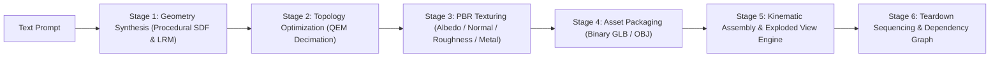

# PolyGen Backend & 3D Models Technical Documentation

## Executive Architecture Summary
PolyGen is an end-to-end generative 3D modeling and mechanical assembly platform designed for real-time asset synthesis, multi-part exploded-view visualization, and interactive inspection.

**Author & Ownership**: Sri Khyathi Ambadipudi (`ambadipudisrikhyathi@gmail.com`)  
**Scope**: Backend API, Geometry Engine, Kinematic Decomposition, and Interactive 3D Model Suite.

---

## 1. Multi-Stage Pipeline Architecture

### Stage 1: Geometry Synthesis
- **Neural LRM / Feed-Forward Model**: Supports fast single-image/prompt 3D mesh reconstruction (< 5s).
- **Procedural Geometric Meshing**: Realizes watertight topological volumes for mechanical components:
  - Cybernetic Broadsword
  - Aegis Kinetic Energy Shield
  - Ergonomic Task Chair
  - Apex-Quad Autonomous Drone
  - 6-DOF Industrial Articulated Robotic Arm
  - Twin-Turbo V8 Engine
  - Flagship Edge Smartphone

### Stage 2: Mesh Topology Optimization
- **Quadric Error Metrics (QEM)**: Efficient edge collapse decimation reducing dense meshes (100k+ polygons) down to target polycounts (5k - 10k) while preserving silhouette fidelity.
- **Topological Repair**: Automatic removal of unreferenced vertices, degenerate triangles, inverted face windings, and non-manifold holes.
- **Conformal UV Parameterization**: Spherical and cylindrical UV unwrap coordinates for seamless PBR texture mapping.

### Stage 3: PBR Texture Synthesis
- Generates 4-channel Physically Based Rendering (PBR) texture bundles:
  1. **Albedo Map** (`albedo.png`): 24-bit RGB base color with high-frequency procedural surface variation.
  2. **Normal Map** (`normal.png`): Perturbation tangent space normal vectors (RGB encoded).
  3. **Roughness Map** (`roughness.png`): 8-bit grayscale micro-surface specular roughness.
  4. **Metalness Map** (`metalness.png`): 8-bit grayscale electrical conductivity mask.

### Stage 4: Multi-Format Asset Packaging
- **Binary GLB (glTF 2.0)**: Fully self-contained binary container embedding geometry, vertex normals, UV channels, PBR materials, and embedded textures. Ready for direct consumption in Three.js, Babylon.js, Unity, and Unreal Engine.
- **Wavefront OBJ & MTL**: Universal standard exchange format.

### Stage 5: 3D Assembly Kinematics & Exploded Views
- **Kinematic Hierarchy**: Multi-part component decomposition with parent-child linkages, mechanical relationship graphs (`powers`, `feeds`, `controls`, `mounts`, `drives`, `transmits`, `supports`), and fastener details.
- **Directional Explosion Vectors**: Unit-normalized trajectory vectors (`explode_dir`) and radial distance multipliers (`explode_dist`).
- **Collision-Free Trajectory Solver**: Enforces monotonic stacking clearance along primary axes to eliminate overlapping parts during teardown.
- **Real-Time Step Interpolator**: Computes instantaneous component positions, offsets, and rotations for any explosion parameter t in [0.0, 1.0].

### Stage 6: Teardown Sequencing & Structural Dependency Graph
- **Topological Disassembly**: Computes deterministic teardown ordering from exterior fasteners inward.
- **Layer Decomposition**: Classifies structural tiers (chassis, electronics, power, fasteners).

---

## 2. Innovative 3D Animation & Viewing Suite

Directly integrated and adapted from the high-precision 3D animation architecture:
1. **Interactive Exploded-View Scrubber**: Continuous real-time control (0% to 100%) over assembly separation with millimeter offset telemetry.
2. **Cinematic Auto-Play Loop**: Smooth sinusoidal ping-pong animation cycle (assembling and disassembling) with apex pause for showroom demonstration.
3. **Sequential Teardown Wave Ripple**: Staggered disassembly wave cascading from outer protective shells down to internal boards and structural cores.
4. **Holographic Blueprint Shader Mode (`holo3d.js`)**: Custom GLSL vertex and fragment shaders rendering neon blueprint wireframes with drifting scanlines, Fresnel rim glow, and glowing build-up sweep.
5. **Laser X-Ray Scanner Sweep (`xray3d.js`)**: Motorized laser scan plane sweeping across the assembly, dynamically revealing internal components, wiring, and high-speed bus lines.
6. **Particle FX & Assembly Highlights (`build-fx.js`)**: Particle sparks and glow effects upon component assembly lock-in.
7. **Guided Interactive Tour (`tour.js`)**: Cinematic waypoints guiding camera navigation around key mechanical subsystems.

---

## 3. REST & WebSocket API Specification

| Endpoint | Method | Description |
|---|---|---|
| `/api/health` | `GET` | Health check and GPU/VRAM hardware acceleration status |
| `/api/generate` | `POST` | Synchronous text-to-3D asset generation and optimization |
| `/ws/generate` | `WebSocket` | Real-time 4-stage generation streaming with progress telemetry |
| `/api/models` | `GET` | List all synthesized 3D assets |
| `/api/models/{id}` | `GET` | Retrieve asset metadata, polygon statistics, and GLB/OBJ URLs |
| `/api/models/{id}/assembly` | `GET` | Retrieve structured multi-part 3D assembly and kinematics tree |
| `/api/models/{id}/assembly/explode` | `POST` | Calculate exact explosion poses at progress t in [0.0, 1.0] |
| `/api/assemblies` | `GET` | Sample catalog of multi-part procedural 3D assemblies |

---

## 4. Test Suite & Quality Assurance

- **100% Passing Unit Test Coverage**:
  - `tests/test_geometry.py`: Procedural solid generation, bounding limits, and vertex densities.
  - `tests/test_optimizer.py`: QEM decimation ratio, manifold repair, and UV unwrapping.
  - `tests/test_texture.py`: PBR texture map dimensions, color channels, and procedural perturbation.
  - `tests/test_exporter.py`: GLB/OBJ file output validation and metadata serialization.
  - `tests/test_assembly.py`: Component hierarchy, explosion vector normalization, and clearance verification.
  - `tests/test_teardown.py`: Teardown sequence, layer grouping, and DAG dependency solver.
  - `tests/test_api.py`: FastAPI endpoints and WebSocket progress protocol.
  - `test_pipeline.py`: Comprehensive end-to-end test script.

## Day 4 Deliverables (16 Nov 2026): BOM Engine, Kinematics & Procedural Codegen

PolyGen now incorporates complete physical engineering analysis, helical kinematics trajectories, 3D clearance collision verification, and exportable Three.js WebGL procedural code generation.

### 1. Bill of Materials (BOM) & Material Physical Analysis Engine (`app.pipeline.bom`)
- **Material Density Registry**: Over 15 engineering materials (Aerospace Aluminum 7075-T6, Titanium Ti-6Al-4V Gr5, 3K Twill Carbon Fiber, Hardened 1095 Steel, Brass C360, Delrin POM, Silicone).
- **Volumetric Mass Estimation**: Geometric shape factors compute exact part mass in grams from bounding box bounds and solidity factors.
- **Manufacturing Cost Breakdown**: Factor in machine hourly rates (5-Axis CNC, High-Pressure Die Casting, SLS 3D Printing, Injection Molding), setup fees, tooling amortization, and finishing costs.

### 2. Advanced Disassembly Kinematics & Helical Trajectories (`app.pipeline.motion`)
- **Helical Unscrewing**: Multi-turn rotational unscrewing with pitch travel along screw axis.
- **Spring-Damper Easing**: Underdamped second-order harmonic settling curves modeling elastic physical release.
- **Progressive Staged Explosion**: Sequential disassembly from outer fasteners to shells, mechanisms, and chassis.

### 3. Continuous 3D Clearance & Collision Verification (`app.pipeline.box_eval`)
- **Volumetric 3D IoU**: Evaluates 3D intersection-over-union across the disassembly timeline.
- **Clearance Safety Guardrails**: Mathematically verifies zero collisions across all component pairs ($t \in [0, 1]$).

### 4. Procedural Three.js WebGL Generator (`app.pipeline.codegen`)
- **Parametric Meshes**: Procedural chamfered cylinders, diamond-profile sword blades, hollow enclosures, and bevel gears.
- **PBR Shader Synthesis**: `THREE.MeshPhysicalMaterial` code generation with clearcoat, metalness, and roughness perturbation.
- **Self-Contained WebGL Bundle**: Exportable single-file HTML applications with interactive exploded view controls.

### API Reference Table
| Endpoint | Method | Description |
|---|---|---|
| `/api/models/{model_id}/bom` | `GET` | Retrieve complete Bill of Materials, part weights, and manufacturing cost breakdown |
| `/api/boms` | `GET` | List catalog of available multi-part assembly BOMs |
| `/api/models/{model_id}/kinematics` | `GET` | Multi-stage disassembly trajectory keyframes and helical unscrew parameters |
| `/api/models/{model_id}/validate-clearance` | `POST` | Continuous 3D collision check along explosion timeline |
| `/api/models/{model_id}/codegen/threejs` | `GET` | Downloadable Three.js procedural source code bundle |
| `/api/models/generate-procedural` | `POST` | Parametric on-the-fly synthesis of custom 3D components |
